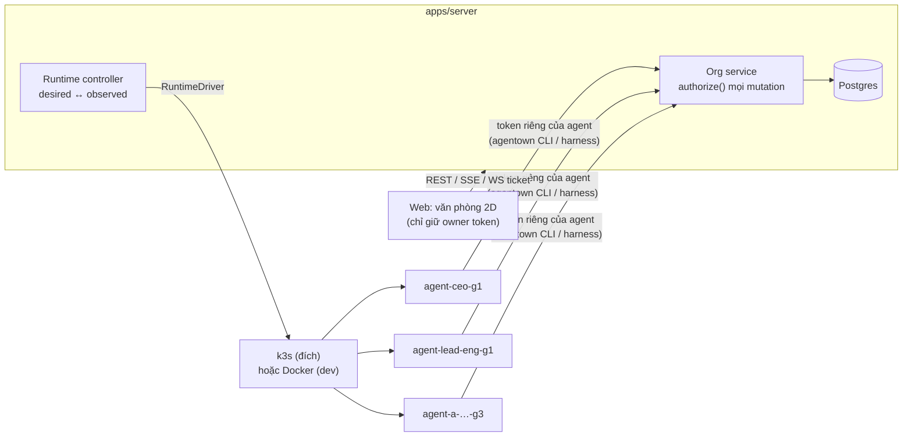

# Agentown

Văn phòng gồm nhiều AI agent có cấp bậc. Mỗi agent có danh tính bền vững, vai trò, môi trường chạy riêng (container/Pod + workspace bền vững) và **quyền riêng do server thực thi** — chức danh CEO/leader/PO không tự sinh quyền. Người dùng quan sát và điều khiển qua một văn phòng 2D trên web.

- Bối cảnh: [`docs/AGENTOWN_HANDOFF.md`](docs/AGENTOWN_HANDOFF.md)
- Quyết định và giả định: [`docs/DECISIONS.md`](docs/DECISIONS.md)

## Trạng thái (v0.1)

| Phần | Trạng thái | Bằng chứng |
|---|---|---|
| Policy engine (default deny, scope theo cây báo cáo, delegation) | ✅ | `packages/core/test/policy.test.ts` (17 test) |
| Org API (spawn, task, lease, artifact, audit, SSE, terminal) | ✅ | `apps/server/test/api.test.ts` (24 test, Postgres thật) |
| Agent thật chạy trong runtime riêng (Docker driver) | ✅ | `scripts/demo.sh`, `verify-runtime.ts` (26 kiểm chứng) |
| Demo CEO → leader → engineer → QA → owner review | ✅ | `scripts/demo.sh` |
| k3s: RBAC controller, Pod Security, admission policy | ✅ trên API server thật | `scripts/verify-k8s-guardrails.sh` (18 kiểm chứng) |
| `KubernetesDriver` tạo SA/PVC/Secret/Pod | ✅ trên API server thật | `apps/server/src/tools/k8s-driver-smoke.ts` |
| Pod agent **chạy** trên k3s | ⚠️ chưa thấy | sandbox build không chạy được Pod — xem DECISIONS |
| Adapter LLM (`claude`) | ⚠️ chưa gọi API thật | cần `ANTHROPIC_API_KEY` |
| UI văn phòng 2D + bảng + panel task/log/quyền/terminal | ✅ | kiểm tra bằng Chromium headless |

## Kiến trúc



```
packages/core      domain contract: actions, scopes, policy engine, config schema, task states
apps/server        Fastify + Postgres: org service, audit, SSE, terminal proxy, controller, drivers
apps/harness       chạy trong runtime: vòng claim → run → report, adapter script/claude, CLI `agentown`, playbooks
apps/web           React + Canvas 2D: văn phòng, bảng agent, panel, terminal (xterm)
config/agentown.yaml  cấu hình tổ chức do owner viết: phòng ban, catalog runtime, profile quyền, template, bootstrap
scripts/           dev-k3s.sh, dev-server.sh, demo.sh, verify-k8s-guardrails.sh
```

## Chạy thử (máy Linux, Docker driver)

Yêu cầu: Node 22, pnpm, Docker, PostgreSQL 16.

```bash
pnpm install
# Postgres: user/password/db = agentown (đổi bằng DATABASE_URL)
createuser -s agentown; createdb -O agentown agentown; createdb -O agentown agentown_test

pnpm --filter @agentown/harness image      # build image runtime agent: agentown/harness:0.1.0
pnpm build:web
AGENTOWN_RUNTIME_DRIVER=docker scripts/dev-server.sh
# lần đầu: owner token ghi vào .agentown/owner-token
```

Mở http://localhost:8080, dán owner token. Trong terminal khác:

```bash
scripts/demo.sh "Agents that ship"                         # owner → CEO → leader → engineer + QA
npx tsx apps/server/src/tools/verify-runtime.ts            # khôi phục, quyền trong runtime, mạng, terminal
pnpm check                                                 # typecheck + unit/integration test
```

Dev UI có hot reload: `pnpm dev:web` (http://localhost:5173, proxy `/api` sang :8080).

## Chạy trên k3s

```bash
# k3s cài sẵn trên host (curl -sfL https://get.k3s.io | sh -), chạy với quyền root:
AGENTOWN_K3S_MODE=native scripts/dev-k3s.sh up
# hoặc k3s trong Docker (kiểu k3d):
scripts/dev-k3s.sh up

scripts/verify-k8s-guardrails.sh                           # RBAC + admission, chạy với quyền controller
scripts/dev-server.sh                                      # AGENTOWN_RUNTIME_DRIVER=kubernetes mặc định
```

`dev-k3s.sh` tạo namespace cho từng phòng ban (Pod Security `restricted`), Role chỉ trong các namespace đó cho ServiceAccount `agentown-controller`, NetworkPolicy chặn ingress và chỉ cho egress tới DNS/API/HTTPS, ResourceQuota, và `ValidatingAdmissionPolicy` từ chối mọi Pod không giống runtime của Agentown (image ngoài catalog, hostPath, host namespace, token k8s, ServiceAccount không khớp agent). Server dùng kubeconfig của **controller SA**, không phải cluster-admin.

## Mô hình quyền (tóm tắt)

- Actor luôn lấy từ token (`Authorization: Bearer`): owner (người) hoặc agent. Không tin `actorId` từ client.
- `authorize(actor, action, target)` **default deny**; chỉ grant mới cho quyền. Action: `org.view`, `task.view|create|assign|review`, `agent.spawn|update|retire`, `runtime.control|logs|exec`, `permission.delegate`.
- Scope: `self`, `direct-reports`, `descendants`, `team`, `department`, `org`, `agents:[…]`, `projects:[…]` — tính trên đồ thị báo cáo **hiện tại**.
- Spawn chỉ từ template được liệt kê trong grant; template mang gói quyền owner đã duyệt. Spawn ≠ cấp quyền.
- Delegation chỉ với grant `delegable`, scope mới phải nằm trong scope cha (chứng minh được), grant con chết theo grant cha hoặc khi người nhận rời cây.
- Task `script` = exec → cần `runtime.exec`. Playbook có sẵn trong image → chỉ cần `task.create`.
- Terminal: `POST /api/agents/:id/terminal-sessions` (kiểm `runtime.exec`) → vé dùng một lần → WebSocket; server đóng phiên khi quyền hoặc generation đổi.
- Audit ghi cả allowed và denied (actor, action, target, lý do, policy revision), không chứa token.

Ma trận quyền mẫu: xem `policyProfiles` trong [`config/agentown.yaml`](config/agentown.yaml). Ví dụ: CEO **không** có `runtime.exec`; leader có exec trên `direct-reports`; PO chỉ thao tác task trong project `website`; worker chỉ `self`.

## API chính

| Endpoint | Mục đích |
|---|---|
| `GET /api/office/snapshot` | snapshot + `cursor` |
| `GET /api/events?after=<cursor>` | SSE delta; reconnect = snapshot mới + cursor |
| `GET/POST /api/agents`, `PATCH /api/agents/:id` | danh sách / spawn từ template (idempotency key) / đổi tên, quan hệ báo cáo |
| `POST /api/agents/:id/pause|resume` | nhận việc mới |
| `POST /api/agents/:id/runtime/start|stop|restart` | runtime (restart = generation mới) |
| `POST /api/agents/:id/retire` | nghỉ việc (`purgeWorkspace` tùy chọn) |
| `GET /api/agents/:id/logs` | log công việc đã lọc secret |
| `POST /api/agents/:id/terminal-sessions` | vé terminal |
| `POST /api/tasks`, `/api/tasks/:id/assign|cancel|retry|review` | vòng đời task |
| `POST /api/grants`, `DELETE /api/grants/:id` | ủy quyền / thu hồi |
| `POST /api/runtime/heartbeat`, `/api/runs/claim`, `/api/runs/:id/*` | dành cho harness (token agent + generation) |
| `GET /api/audit` | audit (owner) |

## Tiêu chí nghiệm thu (handoff §12)

- [x] Mỗi nhân vật ↔ một `agentId`; restart không tạo nhân viên trùng
- [x] CEO spawn theo preset được cấp; yêu cầu lặp lại (idempotency key) không tạo agent trùng
- [x] Leader A điều khiển cấp dưới được cấp; không điều khiển CEO, leader B, nhân viên của B
- [x] PO không có terminal
- [x] Worker không spawn / cấp grant / đọc dữ liệu ngoài quyền
- [x] Gọi API trực tiếp không vượt quyền (mọi kiểm tra ở server; test gọi API thẳng)
- [x] Workload có host mount / image lạ / ServiceAccount sai bị admission từ chối (k3s API server thật)
- [x] Workspace và lịch sử còn sau khi thay runtime
- [x] Mất runtime giữa chừng: đúng một run `lost` + một lần retry, không worker trùng
- [x] UI reconnect: snapshot + cursor; nhịp tim cũ → hiển thị offline
- [x] Terminal kiểm đúng actor/target; đổi quan hệ báo cáo đóng phiên đang mở
- [x] Audit có actor/action/target/kết quả, không lộ secret
- [x] Demo xuyên suốt với agent thật (Docker driver)
- [ ] Pod agent chạy trên k3s thật — cần một host Linux bình thường
- [ ] Agent LLM chạy với API thật — cần API key

## Giới hạn đã biết

- Docker driver không có lớp admission: đảm bảo dựa trên việc chỉ server giữ Docker socket. Token agent nằm trong biến môi trường container (người có Docker socket đọc được). Agent ra Internet không bị chặn ở chế độ Docker (chỉ chặn agent ↔ agent).
- NetworkPolicy k3s cho phép egress HTTPS ra Internet (cho adapter LLM); siết theo preset nếu cần.
- Một process server; SSE fan-out trong bộ nhớ. Nhiều instance cần LISTEN/NOTIFY hoặc broker.
- Nếu reset DB khi container agent vẫn chạy, xoá `.agentown/runtime-secrets/` để controller cấp lại token.
