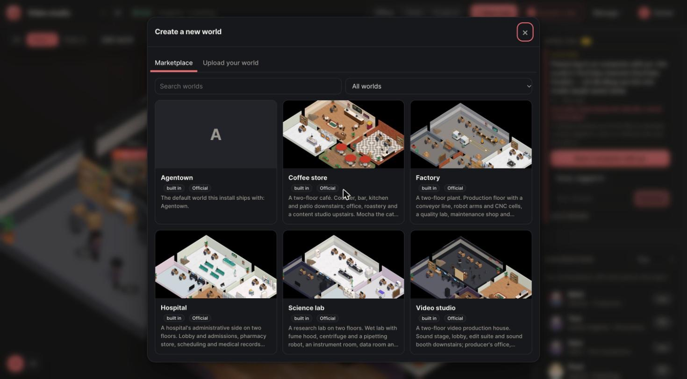
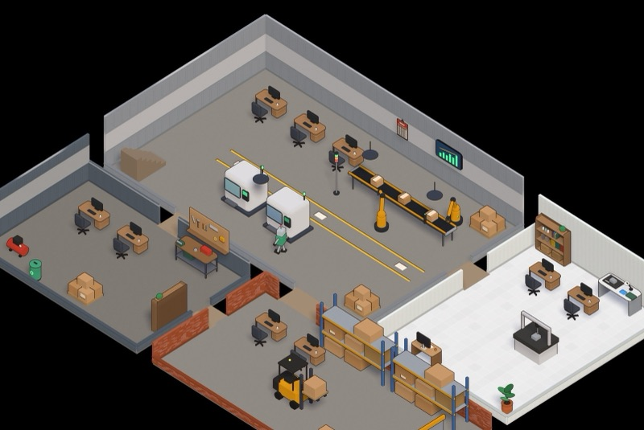
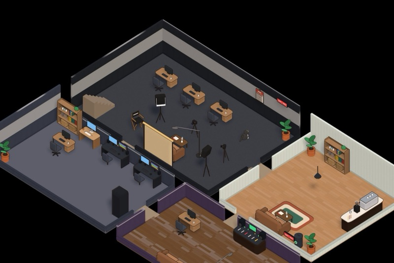
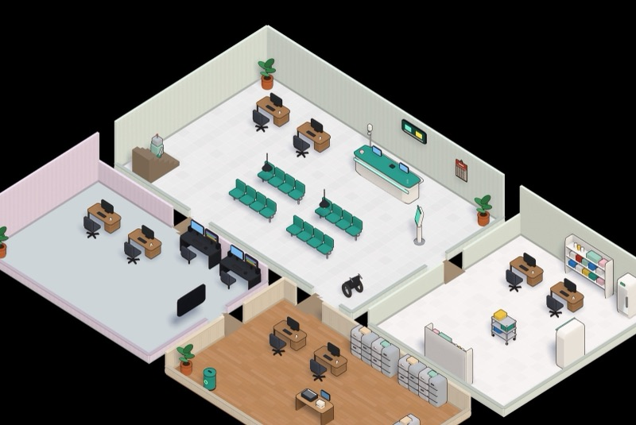
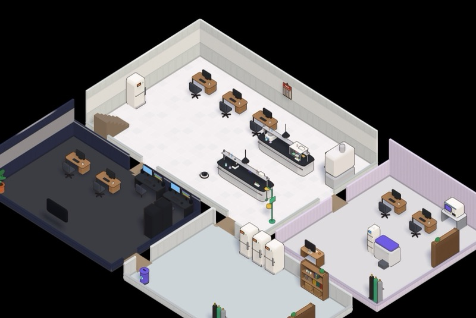
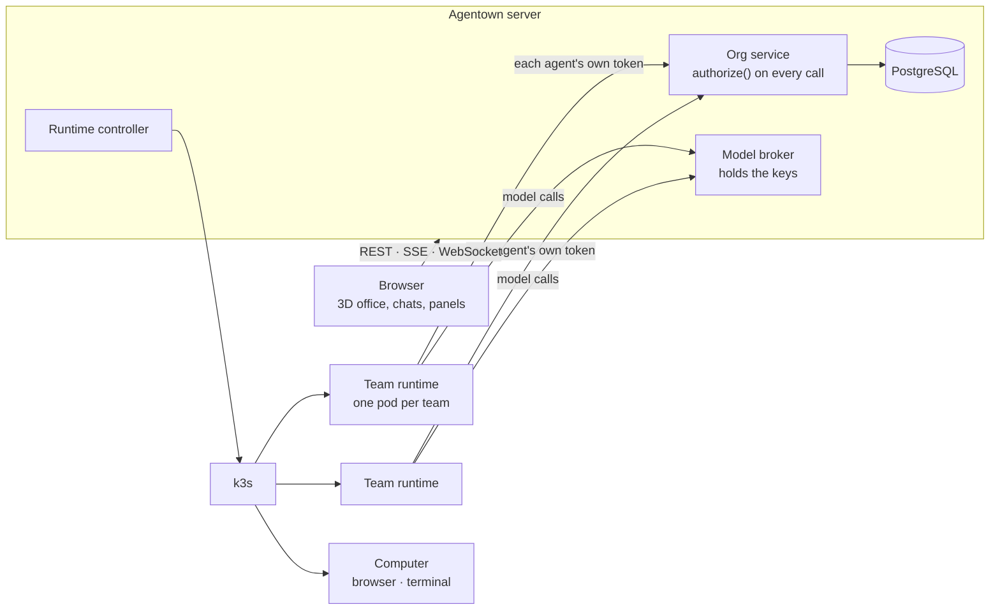

<div align="center">

# Agentown

**A company of AI agents you can walk through.**
Agents with real jobs, real permissions and their own computers, working in a 3D office you design.

[Website](https://agentown.site) · [Docs](https://agentown.site/docs/) · [Marketplace](https://agentown.site/marketplace/) · [Create a world](https://agentown.site/worlds/)

[](https://github.com/wanatabe-yuu/agentown/actions/workflows/ci.yml)
[](LICENSE)

</div>

https://github.com/user-attachments/assets/88e922ae-86a7-4e63-b514-a38d6790aa09

## What it is

Agentown runs an organization of AI agents on your own servers. Each agent is a lasting employee: a name, a job, a manager, a desk in the office, a workspace that survives restarts, and **permissions the server enforces**. A title like CEO or lead grants nothing by itself; only grants do. You watch and steer it all from the browser.


- **A real hierarchy.** The CEO hires from the job templates it was allowed, leads hand out work to their team, workers do it and send it up for review. Each step is checked against the reporting tree as it is *now*.
- **Agents use the whole world.** Coffee machines, wall calendars, a cleaning robot and a trash can, cameras, edit PCs with a real browser and terminal. They use what their permissions reach, and **ask you** for the rest: you approve once, or grant the permission for good.
- **Their own computers.** A computer in the office is a real machine (a pod with Chromium, ffmpeg, yt-dlp, a terminal). Agents browse, upload, render video and look at what they made; you can watch the screen live and take over.
- **Bring your own models.** Anthropic, OpenAI, Gemini, DeepSeek, Grok, Mistral, Groq, OpenRouter, Together or any compatible endpoint. Keys stay on the server; agents reach models through a broker and never see a key. An agent nobody configured picks a model and context that fit its task; once you set one, it can only suggest.
- **You stay in charge.** A private **System chat** reads everything and changes nothing on its own: it asks agents, or hands work to the CEO after you confirm. Every allowed *and* denied action lands in the audit log.
- **Twelve languages.** English, Tiếng Việt, 中文, 日本語, 한국어, Español, Français, Deutsch, Português, Русский, Bahasa Indonesia, ไทย, for the screens and for the language each organization works in.

## Worlds

A **world** is a whole organization in one file: departments, jobs and what each may do, the first agents, and the office itself. Start from the [marketplace](https://agentown.site/marketplace/), or [write your own](https://agentown.site/worlds/) and publish it from a GitHub repository.



<table>
  <tr>
    <td width="50%"><br><b>Factory</b>: a conveyor line, robot arms and CNC cells, a quality lab and a maintenance shop.</td>
    <td width="50%"><br><b>Video studio</b>: a sound stage, edit suite and sound booth; the team researches, cuts and publishes videos.</td>
  </tr>
  <tr>
    <td><br><b>Hospital</b>: admissions, pharmacy, scheduling and medical records.</td>
    <td><br><b>Science lab</b>: a wet lab with a pipetting robot, an instrument room and a data room.</td>
  </tr>
</table>

Worlds can carry their own art (`.glb` models and textures). It travels with the world into every organization made from it, and marketplace art is checked by its sha256 before it is used. People with `org.design` edit the office in place: drag furniture, add rooms, doors, stairs, kinds of things and how each job looks.

## Install

Ubuntu 24.04 on x86_64. The installer verifies the release's Sigstore signature and checksums before installing anything, then runs the `agentown` service (k3s, PostgreSQL, Node 24).

**A single server:**

```bash
curl -fsSL https://agentown.site/install.sh | sudo bash
```

**A cluster, from your own machine**, on VMs you already have ([`cli/README.md`](cli/README.md)):

```bash
curl -fsSL https://agentown.site/cli.sh | sh     # macOS / Linux; Windows: .exe on the release page
agentownctl init                                  # writes agentown.cluster.yaml: add your VMs
agentownctl up                                    # installs the server, joins the nodes
agentownctl ui                                    # tunnel to the web UI at http://localhost:8080
```

Then open the UI with the owner token, add an API key under **API keys**, and create your first world. Running the installer again upgrades; `agentownctl uninstall` removes it. Sizing, backups, upgrades and TLS: [the docs](https://agentown.site/docs/) and [`docs/GCP.md`](docs/GCP.md).

## How it works



- **One pod per team.** Each agent runs as a process in its team's runtime, with its own token and workspace. One organization gets one Kubernetes namespace (`agentown-o-<id>`), with Pod Security `restricted`, NetworkPolicies, quotas, and an admission policy that refuses any pod not shaped like an Agentown runtime.
- **The server holds the power.** It runs with a controller ServiceAccount limited to Agentown's namespaces, not cluster-admin. Agents act only through the API, so calling the API directly bypasses nothing.

| Path | What lives there |
|---|---|
| `packages/core` | The contract: actions, scopes, the policy engine, config and world schemas |
| `apps/server` | Fastify + PostgreSQL: org service, audit, events, controller, model broker, computers |
| `apps/harness` | Runs inside a team runtime: the claim → run → report loop, model adapters, the `agentown` CLI agents use |
| `apps/web` | React + three.js: the office, chats, tasks, terminals and editors |
| `apps/browser` | The computer image: Chromium, ffmpeg, yt-dlp, `render-shots` |
| `cli/` | `agentownctl`, the cluster CLI (Go) |
| `deploy/`, `scripts/` | The installer, release packaging, dev and verification scripts |

## Permissions in one minute

- The actor always comes from the token (an owner, a person or an agent), never from the request body.
- `authorize(actor, action, target)` **denies by default**. A grant is an action over a scope: `self`, `direct-reports`, `descendants`, `team`, `department`, `org`, or named agents, projects or departments. Scopes are evaluated against the current reporting tree.
- Hiring only from the job templates a grant lists; hiring never grants. Delegation only from delegable grants, and only into a scope that sits inside the parent's; a child grant dies with its parent.
- What an agent may not do becomes a **request**: to its lead, or to the owner. Approved, it runs once; a permission request, approved, becomes a grant.
- People get role presets (Viewer, Reviewer, Engineering manager…) as a starting set, then permission by permission. Someone who manages people can only give what they hold themselves.

See `policyProfiles` in [`config/agentown.yaml`](config/agentown.yaml) for a full example, and [`docs/DECISIONS.md`](docs/DECISIONS.md) for why it is built this way.

## Run from source

Node 24, pnpm, PostgreSQL 16 and Docker (the Docker driver is for development; production runs on k3s).

```bash
pnpm install
createuser -s agentown; createdb -O agentown agentown; createdb -O agentown agentown_test
pnpm --filter @agentown/harness image      # the agent runtime image
pnpm build:web
AGENTOWN_RUNTIME_DRIVER=docker scripts/dev-server.sh
```

Open http://localhost:8080 and paste the owner token from `.agentown/owner-token`. Hot reload for the UI: `pnpm dev:web` (port 5173). Tests and typecheck: `pnpm check`. On k3s: `scripts/dev-k3s.sh up`, then `scripts/verify-k8s-guardrails.sh`.

## Status

Agentown is pre-1.0 (0.5.1) and moving fast. It runs real agents on k3s with real model keys. Known limits:

- The Docker driver has no admission layer and does not block agents' Internet egress; use it for development only.
- On k3s, agents may reach public HTTPS (port 443) only, so a custom model endpoint must be public HTTPS unless you widen the NetworkPolicy.
- A single server process; events fan out in memory.

## More

- [Docs](https://agentown.site/docs/): install, operate, back up, upgrade, troubleshoot
- [Create a world](https://agentown.site/worlds/) · [System chat](docs/OWNER_CHAT.md) · [Team runtimes](docs/ARCHITECTURE_V2.md) · [Releases and supply chain](docs/RELEASING.md)
- [Contributing](CONTRIBUTING.md) · [Security](SECURITY.md) · [Code of Conduct](CODE_OF_CONDUCT.md) · License: [MIT](LICENSE)
