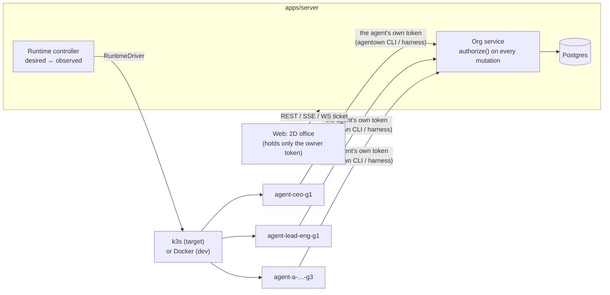

# Agentown

An office of AI agents with a real hierarchy. Each agent has a durable identity, a role, its own runtime (a container/Pod with a persistent workspace) and **its own permissions, enforced by the server**: the titles CEO/leader/PO do not grant anything by themselves. You watch and steer the office through a 2D web view.

- Decisions and assumptions: [`docs/DECISIONS.md`](docs/DECISIONS.md)
- Running on GCP (machine sizing, adding nodes): [`docs/GCP.md`](docs/GCP.md)
- Releases and supply chain (signatures, provenance, SBOM): [`docs/RELEASING.md`](docs/RELEASING.md)

## Install

**A cluster, from your own machine.** Install the `agentownctl` CLI, describe your VMs in a cluster file, and let it set them up over SSH:

```bash
curl -fsSL https://agentown.site/cli.sh | sh     # macOS / Linux; Windows: .exe on the release page
agentownctl init                                  # writes agentown.cluster.yaml: add your VMs
agentownctl up                                    # installs the server, joins the nodes
agentownctl ui                                    # tunnel to the web UI at http://localhost:8080
```

See [`cli/README.md`](cli/README.md).

**A single server, by hand.** SSH into the VM and run:

```bash
curl -fsSL https://agentown.site/install.sh | sudo bash
```

Both paths use the same installer. It needs Ubuntu 24.04 on x86_64, installs the latest release built by GitHub Actions, verifies its Sigstore signature and checksums before installing anything, and runs the `agentown` service (k3s, PostgreSQL, Node 24). Running it again upgrades. Details in [`docs/GCP.md`](docs/GCP.md).

## Status (v0.1)

| Part | Status | Evidence |
|---|---|---|
| Policy engine (default deny, scopes over the reporting tree, delegation) | ✅ | `packages/core/test/policy.test.ts` (18 tests) |
| Org API (spawn, tasks, leases, artifacts, audit, SSE, terminal) | ✅ | `apps/server/test/api.test.ts` (31 tests, real Postgres) |
| Per-agent API key and model | ✅ | credential tests in `api.test.ts`; a bad key is rejected by the real provider |
| One Pod per agent; optionally a dedicated node | ✅ scheduled on real k3s | `k8s-placement-check.ts`: a second dedicated agent is refused a shared node |
| Real agents running in their own runtime (Docker driver) | ✅ | `scripts/demo.sh`, `verify-runtime.ts` (26 checks) |
| Demo CEO → leader → engineer → QA → owner review | ✅ | `scripts/demo.sh` |
| k3s: controller RBAC, Pod Security, admission policy | ✅ on a real API server | `scripts/verify-k8s-guardrails.sh` (18 checks) |
| `KubernetesDriver` creates SA/PVC/Secret/Pod | ✅ on a real API server | `apps/server/src/tools/k8s-driver-smoke.ts` |
| Agent Pods **running** on k3s | ⚠️ not yet observed | the build sandbox cannot run Pods; see DECISIONS |
| LLM adapter (`claude`) | ⚠️ not yet run with a real key | the tool-use loop is tested against a local mock of the Messages API (`apps/harness/test`) |
| 2D office UI + roster + task/log/permission/terminal panels | ✅ | checked with headless Chromium |

## Architecture



```
packages/core      domain contract: actions, scopes, policy engine, config schema, task states
apps/server        Fastify + Postgres: org service, audit, SSE, terminal proxy, controller, drivers
apps/harness       runs inside the runtime: claim → run → report loop, script/claude adapters, `agentown` CLI, playbooks
apps/web           React + Canvas 2D: office, agent roster, panels, terminal (xterm)
config/agentown.yaml  owner-authored org config: departments, runtime catalog, policy profiles, templates, bootstrap
cli/               agentownctl: cluster CLI (Go) that sets up VMs over SSH from your machine
deploy/            install.sh (server installer), install-cli.sh, host agentownctl, gcp/setup-vm.sh
scripts/           dev-k3s.sh, dev-server.sh, demo.sh, verify-k8s-guardrails.sh, package-release.sh, build-cli.sh
```

## Run from source (Linux, Docker driver)

Requirements: Node 24, pnpm, Docker, PostgreSQL 16.

```bash
pnpm install
# Postgres: user/password/db = agentown (override with DATABASE_URL)
createuser -s agentown; createdb -O agentown agentown; createdb -O agentown agentown_test

pnpm --filter @agentown/harness image      # build the agent runtime image: agentown/harness:0.1.0
pnpm build:web
AGENTOWN_RUNTIME_DRIVER=docker scripts/dev-server.sh
# first start: the owner token is written to .agentown/owner-token
```

Open http://localhost:8080 and paste the owner token. In another terminal:

```bash
scripts/demo.sh "Agents that ship"                         # owner → CEO → leader → engineer + QA
npx tsx apps/server/src/tools/verify-runtime.ts            # recovery, in-runtime permissions, network, terminal
pnpm check                                                 # typecheck + unit/integration tests
```

UI development with hot reload: `pnpm dev:web` (http://localhost:5173, proxies `/api` to :8080).

## Run on k3s

```bash
# k3s already installed on the host (curl -sfL https://get.k3s.io | sh -), run as root:
AGENTOWN_K3S_MODE=native scripts/dev-k3s.sh up
# or k3s inside Docker (k3d-style):
scripts/dev-k3s.sh up

scripts/verify-k8s-guardrails.sh                           # RBAC + admission, run with the controller's rights
scripts/dev-server.sh                                      # AGENTOWN_RUNTIME_DRIVER=kubernetes by default
```

`dev-k3s.sh` creates one namespace per department (Pod Security `restricted`), Roles limited to those namespaces for the `agentown-controller` ServiceAccount, NetworkPolicies that block ingress and allow egress only to DNS/the API/HTTPS, ResourceQuotas, and a `ValidatingAdmissionPolicy` that rejects any Pod not shaped like an Agentown runtime (image outside the catalog, hostPath, host namespaces, a k8s token, a ServiceAccount that doesn't match the agent). The server uses the **controller SA's** kubeconfig, not cluster-admin.

## Per-agent API keys and models

- The owner adds keys in the UI (**API keys**). The server checks each key with the provider and stores the list of models that key can use. Keys are encrypted with AES‑256‑GCM and the API only ever returns the last 4 characters. A key can be restricted to certain departments.
- Each agent picks **one key and one of that key's models**, plus effort, max turns and its own instructions (the agent's **Config** tab, or at hiring time). Changing them is the `agent.configure` action: leaders for their direct reports, the CEO for its whole subtree.
- A key is only ever delivered to the runtime of **that agent** (its own Kubernetes Secret / container env). When a key is changed or revoked, the controller replaces the runtime once the agent is idle, without cutting off work in progress. Model, effort and instructions travel with each task, so changing them needs no restart.

## Permission model (summary)

- The actor always comes from the token (`Authorization: Bearer`): the owner (a human) or an agent. A client-supplied `actorId` is never trusted.
- `authorize(actor, action, target)` is **default deny**; only grants give rights. Actions: `org.view`, `task.view|create|assign|review`, `agent.spawn|update|retire`, `runtime.control|logs|exec`, `permission.delegate`.
- Scopes: `self`, `direct-reports`, `descendants`, `team`, `department`, `org`, `agents:[…]`, `projects:[…]`, evaluated against the **current** reporting graph.
- Spawning only from templates listed in the grant; a template carries an owner-approved permission bundle. Spawning ≠ granting.
- Delegation only from `delegable` grants; the new scope must provably sit inside the parent scope; a child grant dies with its parent or when the grantee leaves the tree.
- A `script` task is exec, so it needs `runtime.exec`. A playbook shipped in the image only needs `task.create`.
- Terminal: `POST /api/agents/:id/terminal-sessions` (checks `runtime.exec`) → single-use ticket → WebSocket; the server closes the session when permissions or the generation change.
- The audit log records both allowed and denied calls (actor, action, target, reason, policy revision) and never contains tokens.

Example permission matrix: see `policyProfiles` in [`config/agentown.yaml`](config/agentown.yaml). For example, the CEO has **no** `runtime.exec`; a leader has exec on `direct-reports`; the PO can only work with tasks in the `website` project; a worker only has `self`.

## Main API

| Endpoint | Purpose |
|---|---|
| `GET /api/office/snapshot` | snapshot + `cursor` |
| `GET /api/events?after=<cursor>` | SSE deltas; reconnect = fresh snapshot + cursor |
| `GET/POST /api/agents`, `PATCH /api/agents/:id` | list / spawn from a template (idempotency key) / rename, change reporting line |
| `POST /api/agents/:id/pause|resume` | intake of new work |
| `POST /api/agents/:id/runtime/start|stop|restart` | runtime (restart = new generation) |
| `POST /api/agents/:id/retire` | retire (optional `purgeWorkspace`) |
| `GET /api/agents/:id/logs` | work log with secrets filtered out |
| `POST /api/agents/:id/terminal-sessions` | terminal ticket |
| `POST /api/tasks`, `/api/tasks/:id/assign|cancel|retry|review` | task lifecycle |
| `POST /api/grants`, `DELETE /api/grants/:id` | delegate / revoke |
| `POST /api/runtime/heartbeat`, `/api/runs/claim`, `/api/runs/:id/*` | for the harness (agent token + generation) |
| `GET /api/audit` | audit log (owner) |

## Acceptance criteria

- [x] Each character ↔ one `agentId`; a restart never creates a duplicate employee
- [x] The CEO spawns from the presets it was granted; a repeated request (idempotency key) does not create a duplicate agent
- [x] Leader A controls the reports it was granted; it cannot control the CEO, leader B or B's staff
- [x] The PO has no terminal
- [x] Workers cannot spawn, grant, or read data outside their rights
- [x] Calling the API directly does not bypass permissions (every check is server-side; tests call the API directly)
- [x] Workloads with host mounts, unknown images or the wrong ServiceAccount are rejected by admission (real k3s API server)
- [x] Workspace and history survive a runtime replacement
- [x] Runtime lost mid-task: exactly one `lost` run + one retry, no duplicate worker
- [x] UI reconnect: snapshot + cursor; a stale heartbeat shows as offline
- [x] The terminal checks the right actor/target; changing the reporting line closes open sessions
- [x] Audit has actor/action/target/result and leaks no secrets
- [x] End-to-end demo with real agents (Docker driver)
- [ ] Agent Pods running on real k3s: needs an ordinary Linux host
- [ ] LLM agents running against the real API: needs an API key (add it in the UI → API keys)

## Known limitations

- The Docker driver has no admission layer: the guarantee rests on the server being the only holder of the Docker socket. Agent tokens live in container environment variables (readable by anyone with the Docker socket). Agents' Internet egress is not blocked in Docker mode (only agent ↔ agent traffic is).
- The k3s NetworkPolicy allows HTTPS egress to the Internet (for the LLM adapter); tighten it per preset if needed.
- A single server process; SSE fan-out is in memory. Multiple instances would need LISTEN/NOTIFY or a broker.
- If you reset the DB while agent containers are still running, delete `.agentown/runtime-secrets/` so the controller issues new tokens.

## Contributing & license

- Contributing guide: [CONTRIBUTING.md](CONTRIBUTING.md) · Reporting security issues: [SECURITY.md](SECURITY.md) · [Code of Conduct](CODE_OF_CONDUCT.md)
- License: [MIT](LICENSE)
